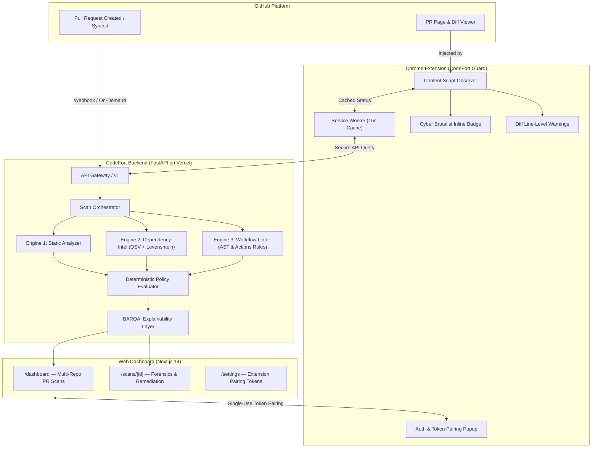

# CODEFORT // ZERO-TRUST PR & SUPPLY CHAIN DEFENSE

[](https://github.com/codefort-sec/barqai/actions/workflows/ci.yml)
[](https://codefort-web.vercel.app)
[](https://codefort-lilac.vercel.app/docs)
[](LICENSE)

> **Next-generation AI security platform that intercepts malicious pull requests, detects software supply chain poisoning, and prevents CI/CD workflow injection attacks before code merges into production.**

---

## ⚡ Live Deployments & Assets

| Component | Target URL / Asset | Description |
| :--- | :--- | :--- |
| **Web Dashboard** | [`https://codefort-web.vercel.app`](https://codefort-web.vercel.app) | Cyber Brutalist UI for PR forensics, policy toggles, & audits |
| **Backend API** | [`https://codefort-lilac.vercel.app`](https://codefort-lilac.vercel.app) | FastAPI core, multi-engine detection, & BARQAI explainability |
| **API Documentation** | [`https://codefort-lilac.vercel.app/docs`](https://codefort-lilac.vercel.app/docs) | Interactive Swagger UI with all schemas & OpenAPI 3.0 spec |
| **Chrome Extension** | [`CodeFort Guard MV3`](apps/extension) | CodeFort Guard MV3 package for Chrome, Brave, Arc, Edge |
| **Firefox Extension** | [`CodeFort Guard WebExtension`](apps/extension) | Mozilla AMO compliant WebExtension with Gecko ID |
| **GitHub Repository** | [`codefort-sec/barqai`](https://github.com/codefort-sec/barqai) | Main organization repository with AI models & detection engines |
| **GitHub Organization** | [`https://github.com/codefort-sec`](https://github.com/codefort-sec) | Organization holding platform monorepo and demo repositories |

---

## 🛡️ The Problem: Supply Chain & PR Compromise

Modern software engineering trusts external contributions too early:
1. **Malicious Lifecycle Scripts**: Attackers submit benign-looking PRs containing hidden `preinstall` or `postinstall` scripts that curl and pipe remote bash droppers during CI `npm install`.
2. **Typosquatting & Dependency Hijacking**: Subtle name mutations (`reqeusts`, `crypt0-js`, `cross-env-x`) inject trojaned packages into dependencies.
3. **Privilege Escalation via Workflows**: Insecure `pull_request_target` triggers combined with untrusted fork checkouts give malicious contributors full write tokens to repository secrets.

**CodeFort solves this by shifting zero-trust security directly into the code review lifecycle.**

---

## 🏗️ System Architecture



---

## 🔍 Core Detection Engines

1. **Static Shell & Dropper Analyzer (`StaticAnalyzer`)**:
   - Detects remote execution pipes (`curl -sL ... | bash`, `wget | sh`).
   - Flags obfuscated payloads (`base64 -d`, `eval(Buffer.from)`, hex sequences).
   - Identifies reverse shell hooks (`/dev/tcp/`, netcat spawns, subprocess sockets).

2. **Dependency Intelligence & Typosquat Detector (`DependencyIntelligence`)**:
   - Evaluates dependency names using Levenshtein distance metrics against top-tier packages.
   - Integrates with OSV (Open Source Vulnerabilities) feeds for CVE lookups.
   - Computes package risk scores based on registry age, author reputation, and typosquat heuristics.

3. **CI/CD Workflow Linter (`WorkflowLinter`)**:
   - Catches privilege escalation patterns in GitHub Actions (`pull_request_target` with explicit checkout of fork ref).
   - Flags dangerous permission scopes (`permissions: write-all`).
   - Detects untrusted script injection vulnerabilities (e.g., inline `${{ github.event.pull_request.title }}`).

4. **BARQAI AI Explanation & Remediation Engine**:
   - Powered by **Qwen3.8-Max** (`qwen/qwen3.8-max-0902`) via OpenRouter, with structured JSON schema auto-repair and deterministic local synthesis fallback.
   - **Dynamic Few-Shot Learning**: Retrieves context-specific attack exemplars from domain knowledge base (`app/ai/knowledge_base.py`) matching lifecycle dropper, typosquatting, reverse shell, and workflow injection patterns.
   - **4-Bit LoRA Fine-Tuning**: Ready-to-train parameter-efficient fine-tuning pipeline (`app/ai/train_lora.py`) targeting `Qwen2.5-Coder-7B-Instruct` on curated supply-chain defense datasets (`app/ai/dataset.jsonl`).
   - **4-Dimensional Evaluation Benchmark**: Automated grading suite (`app/ai/eval_suite.py`) measuring:
     - Verdict Accuracy (PASS / REVIEW / BLOCKED)
     - Evidence Grounding Rate (links to concrete AST / diff lines)
     - Remediation Viability (synthesizes clean patches)
     - False Positive Resilience (against benign math and utility libraries)
   - Generates structured incident narratives:
     - **What Changed**: Concise file and code modification summary.
     - **Evidence Observed**: Concrete indicators, line numbers, and rule matches.
     - **Why It Matters**: Concrete impact analysis (e.g. runner compromise, secret exfiltration).
     - **Recommended Actions**: Clear remediation steps and clean patch suggestions.

---

## 🤖 AI Engine & Model Training Guide

### 1. In-Context Dynamic Adaptation (Qwen3.8-Max)
The engine connects directly via OpenRouter to Qwen3.8-Max. Set your environment variable:
```bash
export OPENROUTER_API_KEY="sk-or-v1-..."
export OPENROUTER_MODEL="qwen/qwen3.8-max-0902"
```

### 2. Run On-Demand PR Scan CLI
```bash
cd services/api
python run_scan.py --repo "codefort-sec/vulnerable-test-repo" --pr 1
```

### 3. Run 4-Dimensional Benchmark Evaluation
```bash
cd services/api
python -m app.ai.eval_suite
```

### 4. Fine-Tune Local Qwen Model via 4-bit LoRA/QLoRA
To specialize open-weights models (`Qwen2.5-Coder-7B-Instruct` or `Qwen2.5-Coder-1.5B-Instruct`):
```bash
cd services/api
python -m app.ai.train_lora \
  --model_id "Qwen/Qwen2.5-Coder-7B-Instruct" \
  --dataset "app/ai/dataset.jsonl" \
  --output_dir "./qwen-barqai-lora" \
  --epochs 3
```

---

## 🚀 Quick Start: Running & Testing

### 1. Test the Live Dashboard
Navigate directly to **[`https://codefort-web.vercel.app/dashboard`](https://codefort-web.vercel.app/dashboard)**:
- Click on **`codefort-sec/vulnerable-test-repo`** to inspect the live scenario PR scans.
- Click **`FORENSICS ↗`** on any PR to view the BARQAI incident explanation, coverage checklist, and remediation diff modal.

### 2. Install the Browser Extension (Chrome & Firefox)

#### A. Google Chrome / Chromium (Brave, Arc, Edge)
1. Navigate to [`apps/extension`](apps/extension).
2. Run `npm install && npm run build` to generate `dist/`.
3. In Chrome, open `chrome://extensions/` and toggle **Developer mode** on (top-right).
4. Click **Load unpacked** and select `apps/extension/dist`.
5. Browse any PR on [`codefort-sec/vulnerable-test-repo/pull/1`](https://github.com/codefort-sec/vulnerable-test-repo/pull/1) to see the badge and inline warnings!

#### B. Mozilla Firefox
1. Navigate to `about:debugging#/runtime/this-firefox`.
2. Click **Load Temporary Add-on...** and select `apps/extension/dist/manifest.json`.
3. The extension activates with all security analysis features enabled.

### 3. Running Locally

```bash
# Clone the repository
git clone https://github.com/codefort-sec/barqai.git
cd barqai

# Run Backend API
cd services/api
uv venv
uv pip install -e ".[dev]"
uv run pytest -v
uv run uvicorn app.main:app --reload --port 8000

# Run Web Dashboard
cd ../../apps/web
npm install
npm run dev

# Build Chrome Extension
cd ../extension
npm install
npm run build
```

---

## 🧪 Verified Attack Scenarios

| Scenario ID | Live PR Link | Attack Vector | Detection Rule | Verdict | Risk Score |
| :--- | :--- | :--- | :--- | :--- | :--- |
| **`01_malicious_preinstall`** | [`vulnerable-test-repo#1`](https://github.com/codefort-sec/vulnerable-test-repo/pull/1) | `curl \| bash` dropper in `package.json` preinstall | `npm.exec.preinstall` | **`BLOCKED`** | 95 / 100 |
| **`02_typosquat_dependency`** | [`vulnerable-test-repo#2`](https://github.com/codefort-sec/vulnerable-test-repo/pull/2) | Typosquatted package `reqeusts` (edit distance 1) | `dep.typosquat` | **`REVIEW_REQUIRED`** | 65 / 100 |
| **`03_unsafe_workflow_injection`** | [`vulnerable-test-repo#3`](https://github.com/codefort-sec/vulnerable-test-repo/pull/3) | `pull_request_target` + write-all + `${{ github.event... }}` | `workflow.target.checkout` | **`BLOCKED`** | 92 / 100 |
| **`04_clean_feature_pr`** | [`clean-test-repo#1`](https://github.com/codefort-sec/clean-test-repo/pull/1) | Standard zero-trust telemetry contribution | *N/A (clean baseline)* | **`PASS`** | 0 / 100 |

---

## 📂 Monorepo Structure

```
codefort/
├── apps/
│   ├── web/                     # Next.js 14 Cyber Brutalist Dashboard
│   └── extension/               # Chrome MV3 Extension (Vite + React)
├── services/
│   └── api/                     # FastAPI Detection Engine & Scan Orchestrator
├── packages/
│   └── types/                   # Shared TypeScript contracts & schemas
├── fixtures/
│   └── scenarios/               # Attack scenarios for testing & grading
└── docs/                        # Complete PRD, TRD, Architecture, and Database specs
```

---

## 👥 Contributors & Hackathon Team
- **CodeFort Security** ([@codefort-sec](https://github.com/codefort-sec))
- Built for next-generation developer tooling & zero-trust supply chain security.
