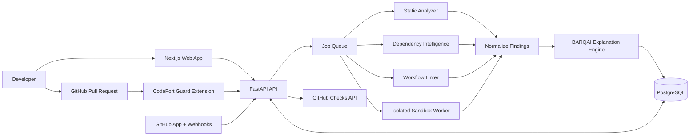

# CodeFort System Architecture

## 1. Overview
CodeFort is a monorepo with three main runtime surfaces:
- `apps/web`: Next.js dashboard and marketing/install pages.
- `apps/extension`: Chrome Manifest V3 extension, built with Vite and React.
- `services/api`: FastAPI backend, scan orchestration, and persistence.
- `packages/types`: shared TypeScript contracts.

PostgreSQL stores users, repositories, PRs, scans, findings, evidence, patches, incidents, and audit events. Background workers run analysis jobs. Optional object storage holds larger restricted artifacts.

## 2. Logical Diagram

## 3. Main Boundaries
### Browser
- Renders dashboard and handles user interaction.
- Uses session cookies or scoped API credentials.
- Never receives server-side private keys.

### Extension
- Runs only on matching GitHub pages.
- Observes URL/navigation and adds compact UI.
- Fetches authoritative status from the API.
- Treats DOM content as untrusted.

### API
- Authentication, authorization, validation, repository integration, policy decisions, and orchestration.
- Webhook receiver should enqueue work and respond quickly.
- Avoid CPU-heavy scanning in request handlers.

### Workers
- Stateless where possible; receive a scan job and immutable commit SHA.
- Run checks in parallel with bounded resources.
- Do not share trusted credentials with sandboxed code.
- Persist results via restricted service identity.

### Persistence
- PostgreSQL for relational state and queryable metadata.
- Object storage for large artifacts with encryption, access control, and retention.
- Store redacted evidence and artifact hashes where practical.

## 4. Scan Lifecycle
`QUEUED → RUNNING → COMPLETED | FAILED | CANCELLED`
A completed scan includes a verdict and per-engine coverage. A failed scan is not a pass. If only some optional engines fail, the scan may complete with partial coverage but must disclose the gap and apply the configured policy.

## 5. Verdict Evaluation
- Engines produce evidence and findings; they do not independently set a global verdict.
- A deterministic policy evaluator maps findings, severities, required-check status, and repository rules to `PASS`, `REVIEW_REQUIRED`, or `BLOCKED`.
- If required checks fail, the result should be `SCAN_ERROR` or `REVIEW_REQUIRED` according to policy, never silently `PASS`.
- Risk score is 0–100, versioned, and shown with contributing factors.

## 6. Recommended Technology
- Web: Next.js App Router, TypeScript, Tailwind CSS, shadcn/ui.
- Extension: Chrome Manifest V3, Vite, React, TypeScript.
- API: Python 3.12, FastAPI, Pydantic.
- Database: PostgreSQL, SQLAlchemy, Alembic.
- Analysis: Semgrep, OSV API, YAML parser/AST checks.
- Jobs: Redis-backed queue or managed queue; select one during implementation.
- Sandbox: disposable container workers with additional isolation controls.
- Observability: structured logs, metrics, tracing, and error reporting.

## 7. Deployment Topology
- Web/API behind HTTPS ingress or gateway.
- PostgreSQL on a private network with encrypted backups.
- Queue and workers in private networks.
- Sandbox worker pool isolated from API/database networks and production secrets.
- Separate development, staging, and production environments.
- CI runs lint, type checks, unit tests, integration tests, dependency scans, and build checks.

## 8. Architecture Decisions to Record
- GitHub OAuth App versus GitHub App responsibilities.
- Queue technology and retry/dead-letter policy.
- Initial supported languages and package ecosystems.
- LLM provider, privacy controls, and fallback behavior.
- Sandbox isolation level and allowed network policy.
- Risk scoring and branch-protection behavior.
