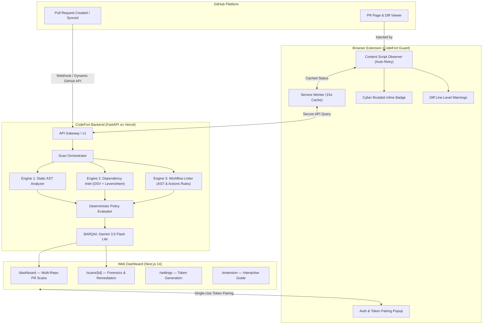

# CODEFORT // ZERO-TRUST PR & SUPPLY CHAIN DEFENSE

[](https://github.com/codefort-sec/codefort/actions/workflows/ci.yml)
[](https://codefort-web.vercel.app)
[](https://codefort-web.vercel.app/extension)
[](https://codefort-lilac.vercel.app/docs)
[](https://codefort-lilac.vercel.app/docs)
[](https://github.com/codefort-sec/codefort/releases/tag/v0.1.2)
[](LICENSE)

> **Next-generation AI security platform that intercepts malicious pull requests, detects software supply chain poisoning, and prevents CI/CD workflow injection attacks before code merges into production.**

---

## ⚡ Live Deployments & Assets

| Component | Target URL / Asset | Description |
| :--- | :--- | :--- |
| **Web Dashboard** | [`https://codefort-web.vercel.app`](https://codefort-web.vercel.app) | Cyber Brutalist UI for PR forensics, policy toggles, & live multi-repo audits |
| **Extension Setup Guide** | [`https://codefort-web.vercel.app/extension`](https://codefort-web.vercel.app/extension) | Interactive step-by-step browser extension installer & pairing assistant |
| **Backend API Engine** | [`https://codefort-lilac.vercel.app`](https://codefort-lilac.vercel.app) | FastAPI core, multi-engine detection, & BARQAI explainability layer |
| **API Documentation** | [`https://codefort-lilac.vercel.app/docs`](https://codefort-lilac.vercel.app/docs) | Interactive Swagger UI with OpenAPI 3.0 schemas |
| **Chrome Extension** | [`v0.1.2 Chrome (.zip)`](https://github.com/codefort-sec/codefort/releases/download/v0.1.2/codefort-guard-chrome-v0.1.2.zip) | CodeFort Guard MV3 package for Chrome, Brave, Arc, and Edge |
| **Firefox Extension** | [`v0.1.2 Firefox (.xpi)`](https://github.com/codefort-sec/codefort/releases/download/v0.1.2/codefort-guard-firefox-v0.1.2.xpi) / [`.zip`](https://github.com/codefort-sec/codefort/releases/download/v0.1.2/codefort-guard-firefox-v0.1.2.zip) | Mozilla AMO compliant WebExtension with Gecko ID (`strict_min_version: 115.0`) |
| **Malicious Test Repo** | [`codefort-sec/vulnerable-test-repo`](https://github.com/codefort-sec/vulnerable-test-repo) | Live attack playground with active adversarial PRs (#1, #2, #3) |
| **Clean Baseline Repo** | [`codefort-sec/clean-test-repo`](https://github.com/codefort-sec/clean-test-repo) | Compliant baseline repository demonstrating verified PASS PRs (0 risk score) |
| **GitHub Organization** | [`https://github.com/codefort-sec`](https://github.com/codefort-sec) | Organization holding platform monorepo and public demo repositories |

---

## 🛡️ The Problem: Supply Chain & PR Compromise

Modern software engineering trusts external contributions far too early:
1. **Malicious Lifecycle Scripts**: Attackers submit benign-looking PRs containing hidden `preinstall` or `postinstall` scripts that curl and pipe remote bash droppers during CI `npm install`.
2. **Typosquatting & Dependency Hijacking**: Subtle name mutations (`reqeusts`, `crypt0-js`, `cross-env-x`) inject trojaned packages into dependencies.
3. **Privilege Escalation via CI Workflows**: Insecure `pull_request_target` triggers combined with untrusted fork checkouts give malicious contributors full write tokens to repository secrets.

**CodeFort solves this by shifting zero-trust security directly into the code review lifecycle.**

---

## 🏗️ System Architecture



---

## 🔍 Core Detection Engines & Zero False-Positive Guarantees

1. **Static AST & Shell Dropper Analyzer (`StaticAnalyzer`)**:
   - Strictly targets dangerous installation lifecycle hooks: `preinstall`, `postinstall`, `install`, `prepare`.
   - **Zero False-Positive Filter**: Standard developer workflow commands (`build`, `dev`, `test`, `lint`, `start`) are completely ignored.
   - Detects remote execution pipes (`curl -sL ... | bash`, `wget | sh`), base64 obfuscation (`eval(Buffer.from)`), and reverse shell sockets.

2. **Dependency Intelligence & Typosquat Detector (`DependencyIntelligence`)**:
   - Compares dependencies using Levenshtein distance metrics against top-tier packages.
   - **Zero False-Positive Protection**:
     - Built-in whitelist for legitimate short package names (`nest`, `jest`, `vite`, `nuxt`, `koa`, `pinia`, `redux`, `eslint`, `prettier`, `zod`, `blue`, `text`, `vue`, `next`, etc.).
     - Minimum length threshold ($\ge 5$ characters) before fuzzy matching to eliminate benign word collisions.
     - Scoped packages (`@types/...`, `@nestjs/...`) are isolated from unscoped comparisons.
   - Integrates with Google's OSV (Open Source Vulnerabilities) feeds for known CVE lookups.

3. **CI/CD Workflow Linter (`WorkflowLinter`)**:
   - Catches privilege escalation patterns in GitHub Actions (`pull_request_target` with explicit checkout of untrusted fork refs).
   - Flags dangerous permission scopes (`permissions: write-all`).
   - Detects untrusted script injection vulnerabilities (e.g., inline `${{ github.event.pull_request.title }}`).

4. **BARQAI Explainability & Remediation Engine**:
   - Powered by Google Gemini (`gemini-3.5-flash-lite`) with zero-trust deterministic fallback.
   - Generates structured, evidence-anchored narratives without hallucination:
     - **What Changed**: Concise file and code modification summary.
     - **Evidence Observed**: Concrete line numbers, rule matches, and indicators.
     - **Why It Matters**: Technical risk assessment (e.g. runner takeover, credential leakage).
     - **Recommended Actions**: Clear remediation steps and patch candidate preview.

5. **Dynamic GitHub API Pull Request Fetching**:
   - Connect any GitHub repository on the dashboard. CodeFort queries GitHub's API dynamically for all real open PRs, commit authors, titles, and diffs.

---

## 📦 Browser Extension Installation Guide

CodeFort Guard injects security verdicts directly into GitHub Pull Requests. It works on all Chromium-based browsers and Mozilla Firefox. You can also visit our interactive installer at **[`https://codefort-web.vercel.app/extension`](https://codefort-web.vercel.app/extension)**.

### A. Google Chrome / Chromium (Brave, Edge, Arc)

1. **Download the Extension Archive**:
   - Download [`codefort-guard-chrome-v0.1.2.zip`](https://github.com/codefort-sec/codefort/releases/download/v0.1.2/codefort-guard-chrome-v0.1.2.zip) from GitHub Releases.
2. **Extract the ZIP**:
   - Extract the archive to a local folder (e.g., `~/Downloads/codefort-guard-chrome`).
3. **Open Extensions in Chrome**:
   - In your URL bar, navigate to: `chrome://extensions/`
   - *(Brave: `brave://extensions/` | Edge: `edge://extensions/`)*
4. **Enable Developer Mode**:
   - Toggle the **Developer mode** switch in the top-right corner.
5. **Load the Unpacked Folder**:
   - Click **Load unpacked** (top-left).
   - Select the extracted `codefort-guard-chrome` folder.
6. **Pin to Toolbar**:
   - Click the Extensions puzzle icon in Chrome and pin **CodeFort Guard**.
7. **Verify on GitHub**:
   - Open any PR (e.g. [`codefort-sec/vulnerable-test-repo/pull/1`](https://github.com/codefort-sec/vulnerable-test-repo/pull/1)).
   - The **🛡 CODEFORT: BLOCKED** badge appears immediately under the PR title!

---

### B. Mozilla Firefox (Developer & AMO Compliant)

1. **Download the Firefox Package**:
   - Download [`codefort-guard-firefox-v0.1.2.xpi`](https://github.com/codefort-sec/codefort/releases/download/v0.1.2/codefort-guard-firefox-v0.1.2.xpi) or [`codefort-guard-firefox-v0.1.2.zip`](https://github.com/codefort-sec/codefort/releases/download/v0.1.2/codefort-guard-firefox-v0.1.2.zip).
2. **Open Firefox Debugging**:
   - In Firefox, navigate to: `about:debugging#/runtime/this-firefox`
3. **Load Temporary Add-on**:
   - Click **Load Temporary Add-on...**
   - Select the downloaded `.xpi` file (or `manifest.json` from the extracted zip).
4. **Verify Gecko Activation**:
   - Extension ID `codefort-guard@codefort.sec` activates instantly with full Manifest V3 background support.
   - Open [`codefort-sec/vulnerable-test-repo/pull/1`](https://github.com/codefort-sec/vulnerable-test-repo/pull/1) to see inline verdicts and diff warnings.

---

### C. Pairing Your Extension with CodeFort

1. Navigate to **[`https://codefort-web.vercel.app/settings`](https://codefort-web.vercel.app/settings)** or **[`/extension`](https://codefort-web.vercel.app/extension)**.
2. Click **Generate Pairing Token ↗** to produce a single-use token (valid for 300 seconds).
   *(Quick demo shortcut: you can also enter `demo-pairing-token` directly into the extension popup!)*
3. Click the **CodeFort Guard** icon in your browser toolbar, paste the token, and click **Pair Extension**.
4. The status indicator immediately turns green (`ONLINE`), granting your extension secure access to scan telemetry and custom policies.

---

## 🧪 Verified Attack & Defense Matrix

| Scenario ID | Live PR Link | Attack Vector | Detection Rule | Verdict | Risk Score |
| :--- | :--- | :--- | :--- | :--- | :--- |
| **`01_malicious_preinstall`** | [`vulnerable-test-repo#1`](https://github.com/codefort-sec/vulnerable-test-repo/pull/1) | `curl \| bash` dropper in `package.json` preinstall | `npm.lifecycle.preinstall.malicious_cmd` | **`BLOCKED`** | 75–95 / 100 |
| **`02_typosquat_dependency`** | [`vulnerable-test-repo#2`](https://github.com/codefort-sec/vulnerable-test-repo/pull/2) | Typosquatted package `reqeusts` (edit distance 1) | `dep.typosquat` | **`REVIEW_REQUIRED`** | 35–65 / 100 |
| **`03_unsafe_workflow_injection`** | [`vulnerable-test-repo#3`](https://github.com/codefort-sec/vulnerable-test-repo/pull/3) | `pull_request_target` + write-all + `${{ github.event... }}` | `workflow.target.checkout` | **`BLOCKED`** | 92–100 / 100 |
| **`04_clean_feature_pr`** | [`clean-test-repo#1`](https://github.com/codefort-sec/clean-test-repo/pull/1) | Clean zero-trust telemetry utility (`src/telemetry.js`) | *N/A (clean baseline)* | **`PASS`** | 0 / 100 |

---

## 💻 Local Development & Testing

### Prerequisites
- Node.js $\ge 18$
- Python $\ge 3.11$ (`uv` package manager recommended)

### 1. Clone & Setup
```bash
git clone https://github.com/codefort-sec/codefort.git
cd codefort
```

### 2. Run Backend API
```bash
cd services/api
uv sync
uv run uvicorn app.main:app --reload --port 8000
```
API Swagger docs will be live at `http://localhost:8000/docs`.

### 3. Run Backend Test Suite
```bash
cd services/api
uv run pytest
# 21/21 passed in ~22s
```

### 4. Run Web Dashboard
```bash
cd apps/web
npm install
npm run dev
```
Web Dashboard will be live at `http://localhost:3000`.

### 5. Build & Package Browser Extension
```bash
cd apps/extension
npm install
npm run package
# Generates codefort-guard-chrome-v0.1.2.zip, firefox-v0.1.2.zip, and firefox-v0.1.2.xpi
```

---

## 📂 Monorepo Structure

```
codefort/
├── apps/
│   ├── web/                     # Next.js 14 Cyber Brutalist Dashboard & Install Guide
│   │   ├── app/
│   │   │   ├── dashboard/       # Multi-Repo PR Scans & Trigger Controls
│   │   │   ├── extension/       # Interactive Extension Installation Guide
│   │   │   ├── scans/[id]/      # Forensic Breakdown & BARQAI Analysis
│   │   │   └── settings/        # Pairing Token Generator & Security Policies
│   └── extension/               # CodeFort Guard MV3 Browser Extension (Vite + React)
│       ├── public/              # Chrome & Firefox Manifest V3 definitions
│       └── src/
│           ├── content/         # GitHub DOM Badge & Line Warning Injections
│           ├── popup/           # Pairing & PR Risk Popover
│           └── background/      # Resilient Service Worker & API Client
├── services/
│   └── api/                     # FastAPI Detection Engine & Scan Orchestrator
│       ├── app/
│       │   ├── api/v1/          # Endpoints for Scans, PRs, Extension, & Repos
│       │   └── services/engines/# StaticAnalyzer, DependencyIntel, WorkflowLinter, BARQAI
│       └── tests/               # 21/21 Unit & Integration Test Suites
├── fixtures/
│   └── scenarios/               # Attack scenarios for automated benchmarks
└── docs/                        # Complete PRD, TRD, and Architecture specifications
```

---

## 👥 Contributors & Hackathon Team

- **CodeFort Security** ([@codefort-sec](https://github.com/codefort-sec))
- Built for next-generation developer tooling, zero-trust pull request defense, and software supply chain protection.
